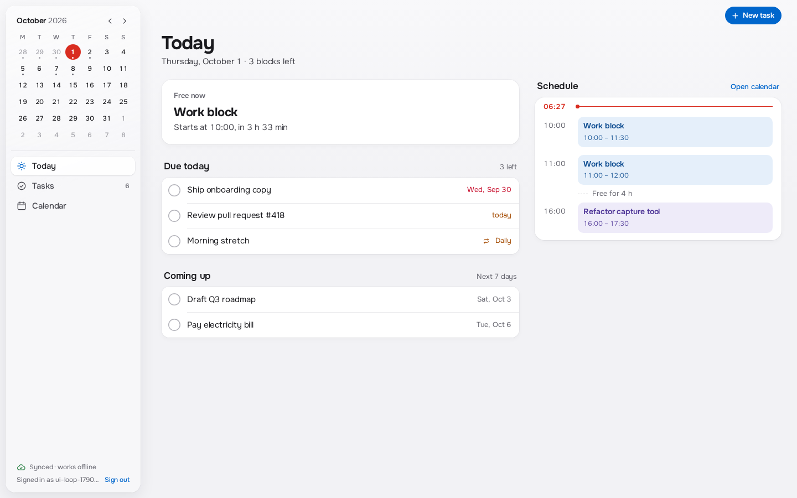
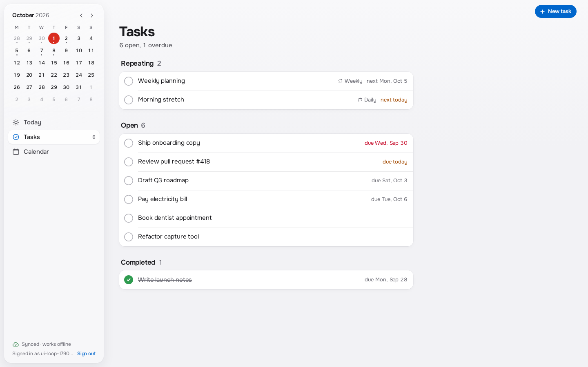
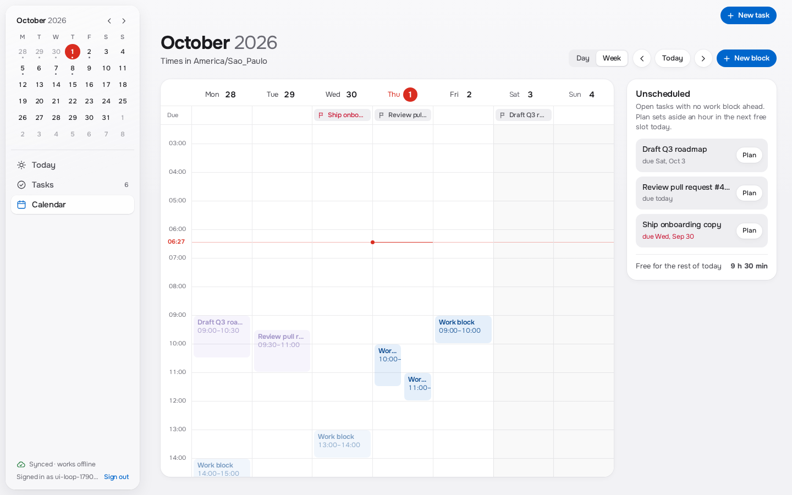
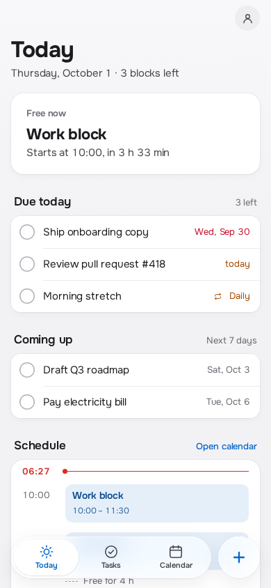

# Personal Planner

A **local-first personal planner**: tasks with date-only deadlines, work blocks, and
recurring series with per-occurrence completion, for one person managing their own time.
It reads and writes offline first and syncs across that person's own devices.

It is **not** a multi-user product: there is no sharing, no teams, no collaboration. It is
also **not related to Mena Nails** — that is a separate studio-booking project in another
repository. This repo exists as a portfolio piece: a small product built end to end,
offline-first, with its tests and its decisions written down.

## Screenshots

| Today | Tasks | Calendar |
| --- | --- | --- |
|  |  |  |

<p align="center"></p>

Captured by `app/scripts/ui-capture.mjs` against the local emulators; no cloud project involved.

## Stack

React 19 + TypeScript + Vite, on Cloud Firestore's persistent local cache (offline reads and
writes, multi-tab). Firebase Auth for sign-in, `vite-plugin-pwa` for the offline app shell and
installability, self-hosted Onest for type. Verification is `node:test` for the domain, a
Firestore-rules test and a Playwright suite against the Firebase Emulator Suite, plus one
offline smoke test against the deployed site.

## Run locally

Requires Node 22.x. Development and the whole local test suite run against the Firebase
Emulator Suite in a `demo-*` project: no cloud project, account or billing.

```sh
cd app
npm ci
npm run emulators   # Auth on 127.0.0.1:9199, Firestore on 127.0.0.1:8187
npm run dev         # in a second terminal
```

The app is origin-driven: `localhost` / `127.0.0.1` uses the demo emulators, while any other
origin connects to the deployed Firebase project. That keeps the local suite structurally
unable to reach production.

## Tests

```sh
cd app
npm test              # domain tests (node:test)
npm run typecheck     # tsc --noEmit
npm run build         # production build
npm run test:emulator # Firestore rules against the Auth + Firestore emulators (needs Java)
npm run test:browser  # Playwright UI suite; starts the emulators and a preview on port 4174
npm run test:smoke    # one offline smoke test against the deployed site (needs credentials)
```

The smoke test is the only one that talks to production. It reads its credentials from the
environment — copy `app/.env.example` to `app/.env` and fill it in, or export them:

```sh
SMOKE_EMAIL=... SMOKE_PASSWORD=... npm run test:smoke
```

Without them it fails fast with a clear message; the unit, emulator and browser suites never
need them. See `app/README.md` for the full verification detail and the offline claims.

## Layout

- `app/` — the product (React + Vite + Firestore), its tests and its capture tooling.
- `odd/` — the durable decision and design records (`odd/tasks/`, `odd/design/`).
- `docs/screenshots/` — the captures above.
- `PRODUCT.md` — the product brief.

## Honest limits

- **Single user.** No sharing, roles or multi-account support.
- **Browser storage is not a backup.** Clearing site data loses the planner; there is no
  export/restore yet.
- **Recurrence** is daily, weekly and monthly. A monthly series skips a month that lacks its
  anchor day (RFC 5545 behavior).
- **Offline claims are bounded by the tests that show them**: shell reload and cached-data
  render offline are covered by the smoke test; physical-device, storage-eviction and
  install-to-home-screen flows are not proven.
- The deployed smoke account's password is still the one that was once committed; it must be
  rotated before this repository is made public (see `odd/tasks/portfolio-cleanup.md`).

## Status

Active personal project. Decisions and increments are tracked in `odd/tasks/personal-planner-mvp.md`;
the visual direction lives in `odd/design/DESIGN.md`.
